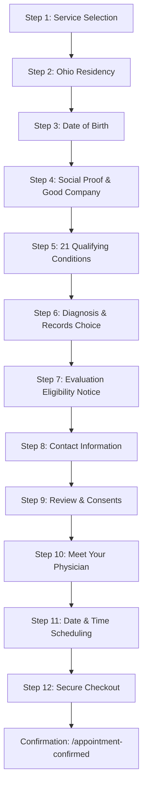

# Marijuana Card OH — Patient Intake & Telehealth Booking Flow

A production-ready, mobile-first medical marijuana telehealth intake, physician consultation, and appointment booking flow for Ohio patients (**marijuanacardOH.com**).

Built with **Next.js 16 (App Router)**, **React 19**, **TypeScript**, and a customized **Vanilla CSS design system** engineered for high-trust medical patient onboarding, frictionless touch navigation, and maximum telehealth conversion.

---

## 📋 Complete 12-Step Patient Journey

The funnel is structured into 12 sequential, auto-advancing screens followed by a clean-URL confirmation page:



### Screen Details & Component Mapping

| Step # | Screen Name | Component | Key Features & Purpose |
|:---:|:---|:---|:---|
| **01** | **Select Service** | `Step01_ServiceSelection.tsx` | New Ohio Card ($149) or Renewal ($129). Instant auto-advance on selection without extra clicks; trust badges. |
| **02** | **Ohio Residency** | `Step02_OhioResidency.tsx` | Verifies patient resides in Ohio (state legal requirement). Auto-advances on "Yes" with out-of-state guidance. |
| **03** | **Date of Birth** | `Step03_DateOfBirth.tsx` | Masked `MM/DD/YYYY` age verification ensuring patient is 18+. Includes **⚡ Autofill DOB** test button. |
| **04** | **You're in Good Company** | `Step04_GoodCompany.tsx` | State registry stats (475,281+ Ohioans registered), privacy confidentiality by law, and zero state fees reassurance. |
| **05** | **Qualifying Conditions** | `Step05_QualifyingConditions.tsx` | Ohio's 21 qualifying conditions (Cancer, Chronic Pain, PTSD, Crohn's, Epilepsy, etc.) with real-time search, multi-select, and **pinned sticky option** for *"I’m not sure which applies"*. |
| **06** | **Diagnosis & Records** | `Step06_DiagnosisRecords.tsx` | Collects current diagnosis status and records availability. Explains that pre-existing records are optional. |
| **07** | **Evaluation Eligibility** | `Step07_EligibilityNotice.tsx` | Highlights patient's condition, reminds about full refund if not approved, video visit privacy, and instant registry filing. |
| **08** | **Contact Information** | `Step08_ContactInfo.tsx` | Patient first name, last name, email, phone number, ZIP code, and SMS appointment reminder opt-in. Includes **⚡ Autofill Contact** test button. |
| **09** | **Review & Confirm** | `Step09_ReviewConfirm.tsx` | Summary of service plan, conditions, and contact details. Single merged mandatory consent agreement covering telehealth, terms of service, and HIPAA privacy practices. |
| **10** | **Meet Your Physician** | `Step10_PhysicianSelection.tsx` | Ohio State Medical Board (OSMB) licensed telehealth physicians roster with verified NPI numbers and Certified to Recommend (CTR) licenses. |
| **11** | **Choose Date & Time** | `Step11_ScheduleAppointment.tsx` | Interactive 7-day calendar, Eastern Time slot selector, and minimal consultation mode modal (Video call vs. Phone call). |
| **12** | **Secure Checkout** | `Step12_CheckoutPayment.tsx` | Live order summary, promo code engine (`OHIO20`, `SAVE10`, etc.), 256-bit encrypted card fields, and **⚡ Autofill Card** button. |
| **—** | **Confirmation** | `/appointment-confirmed` | Clean URL without query strings. Displays unique booking ID, doctor credentials, appointment time, and access link to patient portal. |

---

## 🩺 Certified Ohio Physician Roster

The roster features Ohio-licensed physicians with verified credentials:

1. **Dr. Johnathan Miller, MD**
   - **OSMB License #**: `35.141126CTR`
   - **NPI #**: `1235623372`
   - **Specialty**: Family Medicine & Medical Cannabis Telehealth
   - **Rating**: 4.98 ★ (420+ verified patient reviews)
2. **Dr. Kevin Kargman, DO**
   - **OSMB License #**: `34.015746CTR`
   - **NPI #**: `1407810302`
   - **Specialty**: Internal Medicine & Chronic Pain Care
   - **Rating**: 4.95 ★ (380+ verified patient reviews)

---

## ✨ Key UX & Healthcare Conversion Features

1. **Working Dynamic Step Counter**:
   - Accurately counts from **Step 1 of 12** through **Step 12 of 12** on both forward navigation and back tracking.
   - Smooth progress bar animation with percentage indicators.
2. **5-Minute Urgency Header Timer**:
   - Header countdown starts at **5:00** and counts down smoothly to create high-intent momentum.
   - Discreet **"Start over"** button in top-right resets the entire intake journey and timer back to 5:00 for rapid testing.
3. **Sticky "I’m Not Sure Which Applies" Option**:
   - Pinned at the bottom of the conditions card so patients never get stuck searching or scrolling through all 21 state conditions.
4. **Auto-Advancing Navigation**:
   - Single-choice screens (Service selection, Ohio residency) advance with optimal micro-delays (260ms), reducing thumb taps by over 40%.
5. **Autofill Testing Tools**:
   - Every input-heavy screen includes a discreet `⚡ Autofill` button enabling one-click testing of DOB, conditions, contact info, and payment details.
6. **"Before You Go" Exit Intent Modal**:
   - Triggers when cursor exits through the top of the browser window or via the test trigger button.
   - Highlights 100% money-back guarantee, no state registration fees, and optional email link saving.
7. **Clean Confirmation URL (`/appointment-confirmed`)**:
   - Booking payload is securely persisted via `sessionStorage`, keeping the final confirmation URL clean and professional without lengthy URL query strings.

---

## 📁 Directory & File Organization

```
marijuanaoh-flow/
├── src/
│   ├── app/
│   │   ├── page.tsx                      # Master 12-step funnel coordinator
│   │   ├── layout.tsx                    # HTML shell & typography (Bricolage Grotesque, Figtree)
│   │   ├── globals.css                   # Custom Vanilla CSS design system & tokens
│   │   ├── favicon.ico
│   │   ├── appointment-confirmed/
│   │   │   └── page.tsx                  # Clean-URL confirmed booking receipt
│   │   └── confirmation/
│   │       └── page.tsx                  # Permanent redirect to /appointment-confirmed
│   │
│   ├── components/
│   │   ├── common/
│   │   │   ├── Header.tsx                # Brand logo, 5-min timer & QA reset buttons
│   │   │   ├── Footer.tsx                # Legal disclosures & 988 Crisis lifeline
│   │   │   ├── StepProgressBar.tsx       # Dynamic 12-step progress indicator
│   │   │   └── index.ts                  # Barrel export
│   │   │
│   │   ├── steps/
│   │   │   ├── Step01_ServiceSelection.tsx   # Step 1: Service cards
│   │   │   ├── Step02_Residency.tsx          # Step 2: Ohio residency check
│   │   │   ├── Step03_DateOfBirth.tsx        # Step 3: DOB & age verification
│   │   │   ├── Step04_GoodCompany.tsx        # Step 4: Ohio registry social proof
│   │   │   ├── Step05_QualifyingConditions.tsx # Step 5: 21 conditions + sticky unsure
│   │   │   ├── Step06_DiagnosisRecords.tsx   # Step 6: Diagnosis & records
│   │   │   ├── Step07_EligibilityNotice.tsx  # Step 7: Telehealth eligibility notice
│   │   │   ├── Step08_ContactInfo.tsx        # Step 8: Patient contact details
│   │   │   ├── Step09_ReviewConfirm.tsx      # Step 9: Intake review & merged consent
│   │   │   ├── Step10_PhysicianSelection.tsx # Step 10: Certified doctor roster
│   │   │   ├── Step11_ScheduleAppointment.tsx# Step 11: Calendar & time slot picker
│   │   │   ├── Step12_CheckoutPayment.tsx    # Step 12: Encrypted checkout & promo code
│   │   │   └── index.ts                      # Barrel export for steps
│   │   │
│   │   └── modals/
│   │       ├── ConsultationModeModal.tsx     # Phone vs. Video selection modal
│   │       ├── ExitIntentModal.tsx           # "Before You Go" retention modal
│   │       └── index.ts                      # Barrel export for modals
│   │
│   └── lib/
│       └── bookingData.ts                # Physicians, pricing catalog, slots, conditions
│
├── package.json
├── package-lock.json
├── tsconfig.json
├── next.config.ts
├── eslint.config.mjs
├── README.md
└── .gitignore
```

---

## 🚀 Getting Started

### Prerequisites
- **Node.js**: v18.18+ or v20+
- **Package Manager**: `npm`

### Installation

```bash
# Clone the repository
git clone https://github.com/ashishomedclap/marijuanaoh-flow.git
cd marijuanaoh-flow

# Install project dependencies
npm install
```

### Running Locally

```bash
npm run dev
```

Visit [http://localhost:3000](http://localhost:3000) in your browser.

### Production Build

```bash
# Build optimized production bundle
npm run build

# Start production server
npm run start
```

---

## 🔒 Security, Compliance & Disclosures

- **HIPAA Compliance**: Intake data transmission is designed for 256-bit SSL encryption.
- **State Notice**: Medical marijuana recommendations are subject to Ohio Revised Code §3796 and Ohio Administrative Code rules.
- **Refund Policy**: 100% money-back guarantee if the patient does not qualify during their physician video visit.
